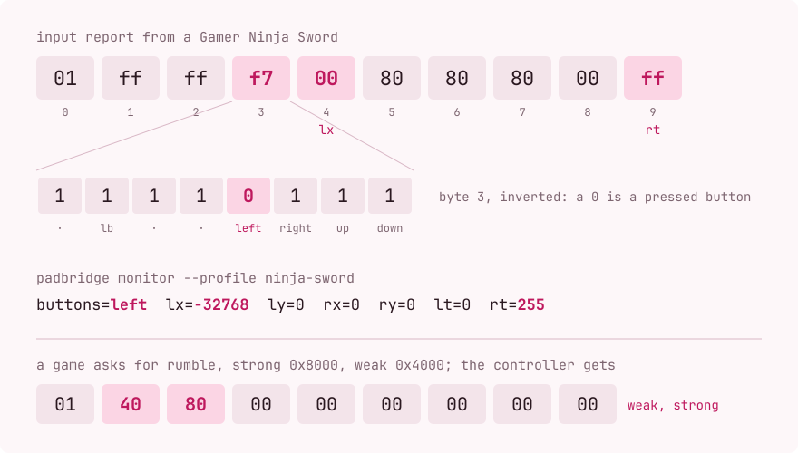

# padbridge

Cheap Bluetooth and USB gamepads often send reports that no game understands: buttons in odd
bits, inverted, and a rumble packet of their own. padbridge reads those reports, maps them through
a small text profile and drives a standard virtual controller (an Xbox 360 pad by default), so the
game sees a controller it knows. Rumble goes the other way: what the game asks for reaches the
controller's motors.

<picture>
  <source media="(prefers-color-scheme: dark)" srcset="docs/report-dark.svg">
  
</picture>

The report above and its decoding come from the test suite: `tests/core` replays it through
`padbridge monitor`, and on Linux checks that a game's rumble reaches the device as that packet.

## Commands

```
padbridge list                      controllers attached to this system
padbridge scan [--seconds N]        Bluetooth controllers nearby, raw HID included
padbridge probe ADDRESS|URI         what a controller exposes and which profile fits
padbridge learn URI [-o FILE]       build a profile by pressing what is asked
padbridge run [URI|ADDRESS|PROFILE]...
padbridge monitor URI               print decoded input as text
padbridge rumble URI STRONG WEAK [MS]
padbridge record URI FILE           capture raw reports to pcapng
padbridge replay FILE               feed a capture through the bridge
padbridge status | stop | release ADDRESS
```

A controller is a URI: `hid:` followed by what `list` prints, `bt:` and a Bluetooth address, or
`replay:` and a pcapng file. `run` with no arguments bridges every attached controller that a
profile matches, plus the Bluetooth address of every profile that names one, and keeps trying to
reach the ones that are away.

## Profiles

```
profile ninja-sword
name Gamer Ninja Sword (Home+X, Bluetooth)
output xbox360 0x045e 0x028e
report 1 10
button a 1.3 invert
button dpad_left 3.3 invert
axis lx 4.0 8
axis rt 9.0 8
rumble 01 00 00 00 00 00 00 00 00
motor strong 2.0 8
motor weak 1.0 8
```

Fields are `byte.bit` and a width in bits; `invert`, `signed`, `big`, `range` and `center` adjust
how a value is read. `rumble` is the packet sent to the controller and `motor` says where each
motor's level goes in it. Built-in profiles live in [`profiles/`](profiles) and are compiled in;
your own go in `~/.config/padbridge/profiles` (`%APPDATA%\padbridge` on Windows,
`~/Library/Application Support/padbridge` on macOS). `padbridge learn` writes one for a controller
padbridge has never seen.

## Platforms

| | Input | Virtual pad |
|---|---|---|
| Linux | hidraw, L2CAP, BlueZ over sd-bus | uinput |
| FreeBSD | hidraw, L2CAP | uinput |
| Windows | hid.dll, descriptor rebuilt from the preparsed data | ViGEmBus |
| macOS 12+ | IOHIDManager | IOHIDUserDevice |

`padbridge backends` says what the running system has.

## Build

It uses seven small C libraries: [bitspan](https://github.com/augustoflorentino/bitspan),
[hid-parser](https://github.com/augustoflorentino/hid-parser),
[report-guess](https://github.com/augustoflorentino/report-guess),
[wirefile](https://github.com/augustoflorentino/wirefile),
[padff](https://github.com/augustoflorentino/padff),
[vpad](https://github.com/augustoflorentino/vpad) and
[cmdspawn](https://github.com/augustoflorentino/cmdspawn). `scripts/deps.sh` fetches each at the
tag padbridge was tested with and installs them under `deps/`, where the build finds them.

```sh
scripts/deps.sh
cmake -S . -B build -DPADBRIDGE_BUILD_TESTS=ON
cmake --build build
ctest --test-dir build
cmake --install build
```

On Linux, `libsystemd` enables scan and pairing through BlueZ. `scripts/cross.sh` builds for
Windows, musl Linux and FreeBSD with `zig cc` and runs the Windows tests under wine.

## Running it as a service

`cmake --install` puts a systemd user unit, an rc.d script or a launchd plist in place, depending on
the system. With systemd: `systemctl --user enable --now padbridge`.

`~/.config/padbridge/padbridge.conf` takes `profiles DIR`, `reconnect SECONDS`,
`log error|warning|info|debug` and `hook COMMAND`. The hook runs through `/bin/sh` on every
`connected`, `disconnected` and `waiting`, with `PADBRIDGE_EVENT`, `PADBRIDGE_CONTROLLER` and
`PADBRIDGE_DETAIL` in its environment.

## License

MIT, see [LICENSE](LICENSE). Changes in [CHANGELOG.md](CHANGELOG.md).
